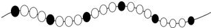

# Mathematics (Grade 3)

**ID**: 2f4c4772
**难度**: medium_hard
**题型**: fill_in_the_blank

## 题目
一串珠子排列如下：请问第43个珠子是$\underline{\hspace{5em}}$色．

## 解答

**答案**: 白

1. Step1:观察图形，确定这组珠子的排列规律是4个珠子为一个循环周期，顺序是●○○○依次循环排列
2. Step2:用43除以循环周期的珠子数4，即43÷4=10…3
3. Step3:根据计算结果，余数为3，说明第43个珠子是一个循环周期中的第3个珠子
4. Step4:按照循环周期的顺序●○○○，确定第3个珠子是白色

## 知识点

**知识点**:
  - 数与形结合的规律．

---
