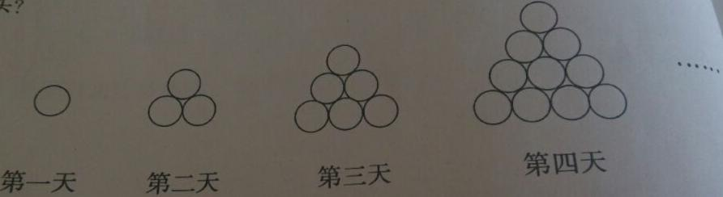

# Mathematics (Grade 3)

**ID**: 30b51418
**难度**: medium_hard
**题型**: fill_in_the_blank

## 题目
黑猩猩垒木头，每天按照下图的垒法垒，这样垒了8天，共垒了多少根木头？

## 解答

**答案**: 36

1. Step1:确定第一天垒的木头数量为1根
2. Step2:确定第二天垒的木头数量为3根
3. Step3:确定第三天垒的木头数量为6根
4. Step4:确定第四天垒的木头数量为10根
5. Step5:分析得出每天垒的木头数量的差数成等差数列
6. Step6:根据等差数列规律推出第五天垒的木头数量为15根
7. Step7:根据等差数列规律推出第六天垒的木头数量为21根
8. Step8:根据等差数列规律推出第七天垒的木头数量为28根
9. Step9:根据等差数列规律推出第八天垒的木头数量为36根

## 知识点

**知识点**:
  - --

---
