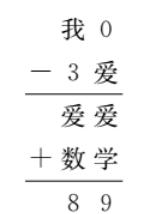

# Mathematics (Grade 3)

**ID**: 318ab7b4
**难度**: medium_hard
**题型**: fill_in_the_blank

## 题目
下面算式中的汉字各代表几？（相同汉字代表相同的数，不同汉字代表不同的数）

我=（）
爱=（）
数=（）
学=（）

## 解答

**答案**: 9, 5, 3, 4

1. Step1:根据竖式中0 - 爱 = 爱，从十位借一，即10 - 爱 = 爱，所以2×爱 = 10，得出爱 = 5
2. Step2:因为爱 = 5，爱加上3再加上借走的1就是我，即5 + 3 + 1 = 9，所以我 = 9
3. Step3:因为爱爱 + 数学 = 89，爱爱 = 55，所以数学 = 89 - 55 = 34，进而得出数 = 3
4. Step4:由数学 = 34，得出学 = 4

## 知识点

**知识点**:
  - 整数的加法和减法

---
