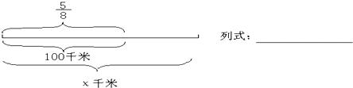

# Mathematics (Grade 3)

**ID**: 328cafe3
**难度**: medium_hard
**题型**: fill_in_the_blank

## 题目
看图列算式或方程，      不计算

## 解答

**答案**: $\frac{5}{8}x=100$

1. Step1:观察线段图，确定将全长设为x千米
2. Step2:根据图中信息，发现全长的$rac{5}{8}$对应的实际长度是100千米
3. Step3:根据上述关系，列出方程$rac{5}{8}x = 100$

## 知识点

**知识点**:
  - 图文应用题．

---
