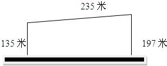

# Mathematics (Grade 3)

**ID**: 3e3d5972
**难度**: medium_hard
**题型**: fill_in_the_blank

## 题目
如图所示，李大爷靠院墙用绳子围出一块空地作为菜园．大约准备多长的绳子就够了？

## 解答

**答案**: 580

1. Step1:明确要求的是围菜园所需绳子的长度，也就是三条边长度之和
2. Step2:三条边长度分别为235米、135米、197米
3. Step3:采用估算的方法，把235估算为240，135估算为140，197估算为200
4. Step4:计算估算后的长度和，即240+140+200=380+200=580米

## 知识点

**知识点**:
  - 整数的加法和减法

---
