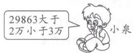

# Mathematics (Grade 3)

**ID**: 3f856360
**难度**: medium_hard
**题型**: fill_in_the_blank

## 题目
照小泉那样说说下列各数在几万与几万之间。

501362 $\underline{\hspace{5em}}$ 
791256 $\underline{\hspace{5em}}$ 
56983241 $\underline{\hspace{5em}}$

## 解答

**答案**: 大于50万，小于51万, 大于79万，小于80万, 大于5698万，小于5699万

1. Step1:分析501362，找到它相邻的整万数，501362大于500000（即50万）且小于510000（即51万）
2. Step2:分析791256，找到它相邻的整万数，791256大于790000（即79万）且小于800000（即80万）
3. Step3:分析56983241，找到它相邻的整万数，56983241大于56980000（即5698万）且小于56990000（即5699万）

## 知识点

**知识点**:
  - 近似数的认识（整数）

---
