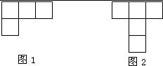

# Mathematics (Grade 3)

**ID**: 4079ba63
**难度**: medium_hard
**题型**: fill_in_the_blank

## 题目
如图的图形都是由边长1厘米的正方形拼成的，在______里填上它们的周长和面积．
图1正方形周长______ 厘米，面积______ 平方厘米；          
图2正方形周长______ 厘米，面积______ 平方厘米．

## 解答

**答案**: 10, 4, 12, 5

1. Step1:根据解析2，数图1封闭图形一周1厘米线段的数量，可得其周长为10厘米
2. Step2:数图1由4个小正方形拼成，根据解析2，用1个小正方形面积1×1平方厘米乘4，可得其面积为4平方厘米
3. Step3:根据解析2，数图2封闭图形一周1厘米线段的数量，可得其周长为12厘米
4. Step4:数图2由5个小正方形拼成，根据解析2，用1个小正方形面积1×1平方厘米乘5，可得其面积为5平方厘米

## 知识点

**知识点**:
  - 正方形的周长;长方形的周长;长方形、正方形的面积．

---
