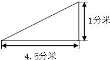

# Mathematics (Grade 3)

**ID**: 40c2a089
**难度**: medium_hard
**题型**: fill_in_the_blank

## 题目
把边长9.5分米的正方形钢板切割成如图的直角三角形（两条直角边的边长分别是4.5分米和1分米）小钢板，最多可切割$\underline{\hspace{5em}}$块．

## 解答

**答案**: 36

1. Step1:明确将两个两条直角边分别是4.5分米和1分米的直角三角形可拼成一个长4.5分米、宽1分米的长方形
2. Step2:计算正方形钢板的边长9.5分米除以长方形长4.5分米，得到9.5÷4.5=2（个）…0.5（分米），即沿正方形边长能剪出2个长4.5分米的长度
3. Step3:计算正方形钢板的边长9.5分米除以长方形宽1分米，得到9.5÷1=9（个）…0.5（分米），即沿正方形边长能剪出9个宽1分米的长度
4. Step4:计算在边长为9.5分米正方形钢板上可切割成长4.5分米、宽1分米的长方形的个数为2×9=18（个）
5. Step5:因为一个长方形可由两个直角三角形拼成，所以可切割成三角形的个数为18×2=36（个）

## 知识点

**知识点**:
  - 图形的拼组．

---
