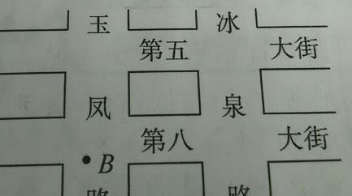

# Mathematics (Grade 3)

**ID**: 4171843f
**难度**: medium_hard
**题型**: fill_in_the_blank

## 题目
下图中的街道,(    )与(    )平行,(    )与(    )平行;(    )与(    )垂直,(    )与(    )垂直.

## 解答

**答案**: 第五大道, 第八大道, 玉凤路, 冰泉路, 玉凤路, 第五大道, 冰泉路, 第八大道

1. Step1:观察图片，明确判断依据为在同一平面内，永不相交的两条直线叫平行线，一条线与另一条线相交成90°这两条直线互相垂直
2. Step2:根据判断依据，找出水平方向上永不相交的两条街道，即第五大道与第八大道，确定这两条街道平行
3. Step3:再找出垂直方向上永不相交的两条街道，即玉凤路与冰泉路，确定这两条街道平行
4. Step4:观察垂直方向和水平方向相交的街道，发现玉凤路与第五大道相交成90°，确定这两条街道垂直
5. Step5:同样，发现冰泉路与第八大道相交成90°，确定这两条街道垂直

## 知识点

**知识点**:
  - 

---
