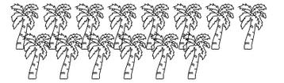

# Mathematics (Grade 3)

**ID**: 429034b5
**难度**: medium_hard
**题型**: fill_in_the_blank

## 题目
一共有几棵树呢？

□+□=□（棵）

## 解答

**答案**: 8, 6, 14

1. Step1:观察图形，数出第一行树的数量为8棵
2. Step2:观察图形，数出第二行树的数量为6棵
3. Step3:根据整数加法的意义，求树的总数用加法计算，即8 + 6
4. Step4:计算8 + 6的结果为14，得出树的总数为14棵

## 知识点

**知识点**:
  - 整数的加法和减法;看图列式

---
