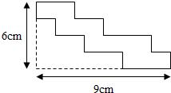

# Mathematics (Grade 3)

**ID**: 4380e3c3
**难度**: medium_hard
**题型**: fill_in_the_blank

## 题目
如图的周长是$\underline{\hspace{5em}}$厘米．

## 解答

**答案**: 30

1. Step1:将图形的横线部分进行平移和整合，得到所有横线的长度和为9+9=18厘米
2. Step2:将图形的竖线部分进行平移和整合，得到所有竖线的长度和为6+6=12厘米
3. Step3:图形的周长等于横线长度和与竖线长度和相加，即18+12=30厘米

## 知识点

**知识点**:
  - 巧算周长．

---
