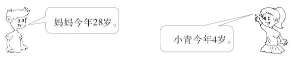

# Mathematics (Grade 3)

**ID**: 48bfd2c1
**难度**: medium_hard
**题型**: fill_in_the_blank

## 题目

今年妈妈的岁数是小青的几倍？
列式计算 $\underline{\hspace{5em}}$

## 解答

**答案**: 7

1. Step1:明确问题是求今年妈妈的岁数是小青的几倍
2. Step2:根据除法的意义，求一个数是另一个数的几倍用除法计算
3. Step3:已知妈妈今年28岁，小青今年4岁，所以列出算式28÷4
4. Step4:计算28÷4的结果为7

## 知识点

**知识点**:
  - 整数除法应用题

---
