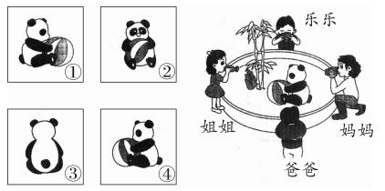

# Mathematics (Grade 3)

**ID**: 4981ebf7
**难度**: medium_hard
**题型**: fill_in_the_blank

## 题目
看图填一填。

爸爸拍的是第（）张照片；妈妈拍的是第（）张照片；姐姐拍的是第（）张照片；乐乐拍的是第（）张照片。

## 解答

**答案**: ④, ③, ②, ①

1. Step1:确定爸爸的位置在熊猫左侧
2. Step2:确定妈妈的位置在熊猫后面
3. Step3:确定乐乐的位置在熊猫右侧
4. Step4:确定姐姐的位置在熊猫前面
5. Step5:判断图1是熊猫的右侧
6. Step6:判断图2是熊猫的前面
7. Step7:判断图3是熊猫的后面
8. Step8:判断图4是熊猫的左侧
9. Step9:得出爸爸拍的是第④张照片
10. Step10:得出妈妈拍的是第③张照片
11. Step11:得出姐姐拍的是第②张照片
12. Step12:得出乐乐拍的是第①张照片

## 知识点

**知识点**:
  - 从不同方向观察物体

---
