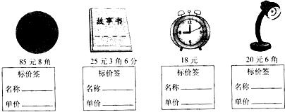

# Mathematics (Grade 3)

**ID**: 4e36f7e9
**难度**: medium_hard
**题型**: fill_in_the_blank

## 题目
动手做一做．
给下面商品制作价格标签，以元为单位，     精确到分．

## 解答

**答案**: 85.80, 25.36, 18.00, 20.60

1. Step1:明确元、角、分之间的进率为10，改写时小数点前是元，小数点后第一位是角，第二位是分
2. Step2:将85元8角进行改写，8角换算为0.8元，得到85.80元
3. Step3:将25元3角6分进行改写，3角换算为0.3元，6分换算为0.06元，得到25.36元
4. Step4:18元直接写成18.00元
5. Step5:将20元6角进行改写，6角换算为0.6元，得到20.60元

## 知识点

**知识点**:
  - 货币、人民币及其常用单位．

---
