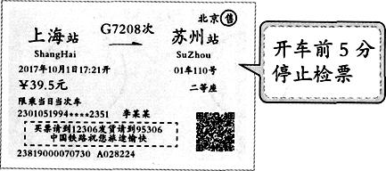

# Mathematics (Grade 3)

**ID**: 510b7076
**难度**: medium_hard
**题型**: fill_in_the_blank

## 题目
生活中的数学。

(1)火车在下午（______）时（______）分开车，下午（______）时（______）分停止检票。
(2)这张火车票在（______）年（______）月（______）日使用才有效。
(3)小明一家从家到火车站检票口要55分，他们最晚要在（______）时（______）分从家里出发才不会误火车。

## 解答

**答案**: 5, 21, 5, 16, 2017, 10, 1, 16, 21

1. Step1:根据火车票上的信息，开车时间为2017年10月1日17:21，17 - 12 = 5，所以火车在下午5时21分开车
2. Step2:已知开车前5分钟停止检票，21 - 5 = 16，所以下午5时16分停止检票
3. Step3:从火车票上可直接看出有效日期为2017年10月1日
4. Step4:小明一家从家到火车站检票口要55分，停止检票时间是17时16分，17时16分 - 55分 = 16时21分，所以他们最晚要在16时21分从家里出发才不会误火车

## 知识点

**知识点**:
  - 小学数学;数与代数;常见的量;时间单位及换算

---
