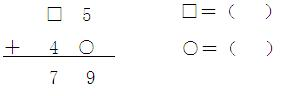

# Mathematics (Grade 3)

**ID**: 563af92c
**难度**: medium_hard
**题型**: fill_in_the_blank

## 题目
请你猜一猜，□和○各代表什么数字？

## 解答

**答案**: 3, 4

1. Step1:观察竖式可知是两位数的加法运算，个位上是5 + ○ = 9
2. Step2:根据加数 = 和 - 另一个加数，可得○ = 9 - 5 = 4
3. Step3:再看十位，□ + 4 = 7
4. Step4:根据加数 = 和 - 另一个加数，可得□ = 7 - 4 = 3

## 知识点

**知识点**:
  - 整数的加法和减法

---
