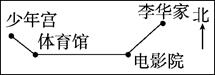

# Mathematics (Grade 3)

**ID**: 57f51bfd
**难度**: medium_hard
**题型**: fill_in_the_blank

## 题目

李华从家出发，向（______）方向走到电影院，又向（______）走到体育馆，再向（______）方向走到少年宫。

## 解答

**答案**: 西南, 西, 西北

1. Step1:根据地图“上北下南，左西右东”的规则，判断电影院在李华家的左下方，所以李华从家出发向西南方向走到电影院
2. Step2:依据同样的地图规则，体育馆在电影院的正左方，所以李华从电影院出发向西走到体育馆
3. Step3:按照地图规则，少年宫在体育馆的左上方，所以李华从体育馆出发向西北方向走到少年宫

## 知识点

**知识点**:
  - 

---
