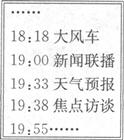

# Mathematics (Grade 3)

**ID**: 5cde9779
**难度**: medium_hard
**题型**: fill_in_the_blank

## 题目
每个星期六晚上小红全家都坐在一起看电视。

(1)小红最喜欢的《大风车》节目是从(    )开始的。
(2)爸爸从19:00开始看电视，正在播放的节目是(    )。
(3)妈妈最关心的节目只有5分钟，是(    )。
(4)从《大风车》开始看到《焦点访谈》结束，共看了多长时间？

## 解答

**答案**: 18:18, 《新闻联播》, 《天气预报》, 1小时37分钟

1. Step1:根据节目时间表可知，《大风车》节目是从18:18开始，所以(1)的答案是18:18
2. Step2:节目时间表显示19:00正在播放的节目是《新闻联播》，所以爸爸19:00开始看电视时正在播放的节目是《新闻联播》，(2)的答案是《新闻联播》
3. Step3:节目时间表中时长为5分钟的节目是《天气预报》，所以妈妈最关心的只有5分钟的节目是《天气预报》，(3)的答案是《天气预报》
4. Step4:《大风车》18:18开始，《焦点访谈》19:55结束，19时55分－18时18分＝1小时37分钟，所以(4)的答案是1小时37分钟

## 知识点

**知识点**:
  - 小学数学;数与代数;常见的量;时间单位及换算

---
