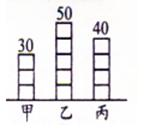

# Mathematics (Grade 3)

**ID**: 5ecf1cbb
**难度**: medium_hard
**题型**: fill_in_the_blank

## 题目
如图，甲、乙、丙分别有邮票30张、50张和40张，乙给甲 $\underline{\hspace{5em}}$ 张时，三个人的邮票同样多。

## 解答

**答案**: 10

1. Step1:先计算三人邮票的总数，即30 + 50 + 40 = 120（张）
2. Step2:再计算三人邮票数量的平均数，120÷3 = 40（张）
3. Step3:最后计算乙需要给甲的邮票数，用乙原有的邮票数50张减去平均数40张，即50 - 40 = 10（张）

## 知识点

**知识点**:
  - 平均数、中位数、众数的意义及求法

---
