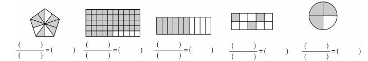

# Mathematics (Grade 3)

**ID**: 5f27f5a4
**难度**: medium_hard
**题型**: fill_in_the_blank

## 题目
分别用分数和小数表示下面每个图中涂色部分的大小。      

## 解答

**答案**: 0.7, 0.9, 0.6, 0.3, 0.75

1. Step1:观察第一个图形，它被平均分成10份，涂色部分是7份，用分数表示为$rac{7}{10}$，7÷10=0.7，用小数表示为0.7
2. Step2:观察第二个图形，它被平均分成50份，涂色部分是45份，用分数表示为$rac{45}{50}$，45÷50=0.9，用小数表示为0.9
3. Step3:观察第三个图形，它被平均分成10份，涂色部分是6份，用分数表示为$rac{6}{10}$，6÷10=0.6，用小数表示为0.6
4. Step4:观察第四个图形，它被平均分成10份，涂色部分是3份，用分数表示为$rac{3}{10}$，3÷10=0.3，用小数表示为0.3
5. Step5:观察第五个图形，它被平均分成4份，涂色部分是3份，用分数表示为$rac{3}{4}$，3÷4=0.75，用小数表示为0.75

## 知识点

**知识点**:
  - 分数的认识;小数和分数的互化

---
