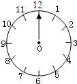

# Mathematics (Grade 3)

**ID**: 5f745a9a
**难度**: medium_hard
**题型**: fill_in_the_blank

## 题目
如图：
（1）指针从“12”绕点O顺时针旋转30°到$\underline{\hspace{5em}}$．
（2）指针从“3”绕点O顺时针旋转$\underline{\hspace{5em}}$°到“6”．
（3）指针从“6”绕点O顺时针旋转$\underline{\hspace{5em}}$°到“12”．

## 解答

**答案**: 1, 90, 180

1. Step1:因为时针一大格是30°，指针从“12”绕点O顺时针旋转30°，正好旋转一大格，所以到1
2. Step2:指针从“3”到“6”，经过了3大格，每大格30°，3×30°=90°，所以指针从“3”绕点O顺时针旋转90°到“6”
3. Step3:指针从“6”到“12”，经过了6大格，每大格30°，6×30°=180°，所以指针从“6”绕点O顺时针旋转180°到“12”

## 知识点

**知识点**:
  - 将简单图形平移或旋转一定的度数．

---
