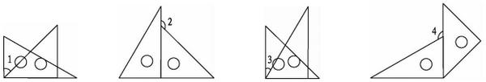

# Mathematics (Grade 3)

**ID**: 60d0519d
**难度**: medium_hard
**题型**: fill_in_the_blank

## 题目
用三角板摆一摆，再算一算下列的角各是多少度。

∠1= $\underline{\hspace{5em}}$     ∠2= $\underline{\hspace{5em}}$     ∠3= $\underline{\hspace{5em}}$     ∠4= $\underline{\hspace{5em}}$

## 解答

**答案**: 45°, 135°, 30°, 120°

1. Step1:根据三角板特征及角的计算方法，第1幅图中，因为∠1是由直角（90°）减去45°角得到的，所以∠1=90° - 45° = 45°
2. Step2:第2幅图中，由于∠2与45°角的和是平角（180°），所以∠2=180° - 45° = 135°
3. Step3:第3幅图中，因为∠3是由直角（90°）减去60°角得到的，所以∠3=90° - 60° = 30°
4. Step4:第4幅图中，由于∠4与60°角的和是平角（180°），所以∠4=180° - 60° = 120°

## 知识点

**知识点**:
  - 角的认识

---
