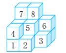

# Mathematics (Grade 3)

**ID**: 66a923d8
**难度**: medium_hard
**题型**: fill_in_the_blank

## 题目
如图中共有（）个小正方体，拿去（）号小正方体，从前面、左面、上面看到的图形不会改变。

## 解答

**答案**: 16, 5

1. Step1:观察图形可知组合体有3层，分别数出每层小正方体个数，最底层有8个，中间层有6个，最上层有2个
2. Step2:将每层小正方体个数相加，8 + 6 + 2 = 16，得到小正方体总数为16个
3. Step3:分析要使从上面看到的图形不变，最底层小正方体不能动
4. Step4:分析要使从前面看到的图形不变，最上层小正方体不能动
5. Step5:由此确定考虑拿去中间层小正方体
6. Step6:观察中间层4、5、6号正方体位置，得出拿去5号小正方体，从前面、左面、上面看到的图形不会改变

## 知识点

**知识点**:
  - 从不同方向观察物体

---
