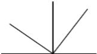

# Mathematics (Grade 3)

**ID**: 6c0ea1a7
**难度**: medium_hard
**题型**: fill_in_the_blank

## 题目
下面图中共有 $\underline{\hspace{5em}}$ 角，其中有 $\underline{\hspace{5em}}$ 个锐角、 $\underline{\hspace{5em}}$ 个直角、 $\underline{\hspace{5em}}$ 个钝角、 $\underline{\hspace{5em}}$ 平角．

## 解答

**答案**: 10, 4, 3, 2, 1

1. Step1:计算图中角的总数，根据组合数计算方法，从4个单独小角出发，总数为4+3+2+1=10个
2. Step2:根据锐角定义（小于90度的角），数出图中锐角个数为4个
3. Step3:根据直角定义（等于90度的角），数出图中直角个数为3个
4. Step4:根据钝角定义（大于90度小于180度的角），数出图中钝角个数为2个
5. Step5:根据平角定义（等于180度的角），数出图中平角个数为1个

## 知识点

**知识点**:
  - 角的概念及其分类

---
