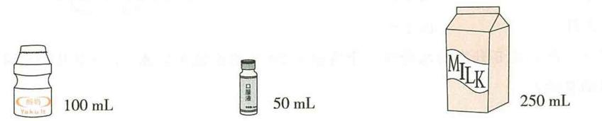

# Mathematics (Grade 3)

**ID**: 6d7b9b1f
**难度**: medium_hard
**题型**: fill_in_the_blank

## 题目
下面容器分别需要多少瓶（盒）才正好是1升？

    100mL  50mL  250mL
    （    ）瓶  （    ）瓶  （    ）瓶

## 解答

**答案**: 10, 20, 4

1. Step1:将1升换算为毫升，因为1L = 1000mL
2. Step2:计算100mL的容器需要的数量，1000÷100 = 10瓶
3. Step3:计算50mL的容器需要的数量，1000÷50 = 20瓶
4. Step4:计算250mL的容器需要的数量，1000÷250 = 4瓶

## 知识点

**知识点**:
  - 升和毫升-认识毫升和进率
-

---
