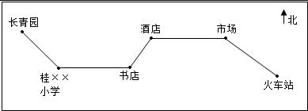

# Mathematics (Grade 3)

**ID**: 6de72630
**难度**: medium_hard
**题型**: fill_in_the_blank

## 题目
请你根据公交线路图，写出和平小学到火车站的行车路线．从桂××小学出发，先向东走到______，接着向______方向走到酒店，接着向______方向走到______，再向______方向走就到火车站了．

## 解答

**答案**: 书店, 东北, 正东, 市场, 东南

1. Step1:根据线路图和上北下南左西右东的方向原则，从桂××小学出发，其正东方向的地点是书店，所以第一个空填书店
2. Step2:以书店为观测点，酒店在书店的右上方，即东北方向，所以第二个空填东北
3. Step3:以酒店为观测点，观察其正东方向的地点是市场，所以第三个空填正东，第四个空填市场
4. Step4:以市场为观测点，火车站在市场的右下方，即东南方向，所以第五个空填东南

## 知识点

**知识点**:
  - 路线图．

---
