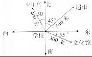

# Mathematics (Grade 3)

**ID**: 6e8e81ea
**难度**: medium_hard
**题型**: fill_in_the_blank

## 题目
以学校为观测点，填一填
（1）超市在学校(     )偏(     )的方向上，距离是(     )米．
（2）文化馆在学校(     )偏(     )的方向上，距离是(     )米．
（3）(     )在学校北偏西30度的方向上，距离是(     )米．

## 解答

**答案**: 北, 东45°, 500, 东, 南35°, 300, 少年宫, 400

1. Step1:根据地图方向上北下南，左西右东及图中信息，确定超市相对于学校的方向为北偏东，角度为45°，距离是500米
2. Step2:根据地图方向及图中信息，确定文化馆相对于学校的方向为东偏南，角度为35°，距离是300米
3. Step3:根据地图方向及图中信息，确定在学校北偏西30度方向上的是少年宫，距离是400米
4. Step4:将上述信息整理成答案列表，依次为超市方向的北、东45°、距离500，文化馆方向的东、南35°、距离300，以及少年宫和其距离400

## 知识点

**知识点**:
  - 根据方向和距离确定物体的位置

---
