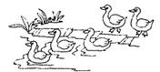

# Mathematics (Grade 3)

**ID**: 705f1a7a
**难度**: medium_hard
**题型**: fill_in_the_blank

## 题目
池塘里原来有12只鸭子和8只鹅，有5只鸭子上岸后，池塘里还有几只鸭子？

## 解答

**答案**: 7

1. Step1:明确题目所求为池塘里剩余鸭子的数量
2. Step2:确定鸭子原来的总数是12只
3. Step3:确定上岸鸭子的数量是5只
4. Step4:根据从总数里去掉一部分用减法计算的原则，用鸭子总数12只减去上岸的5只，即12 - 5
5. Step5:计算得出结果为7只

## 知识点

**知识点**:
  - 整数的加法和减法

---
