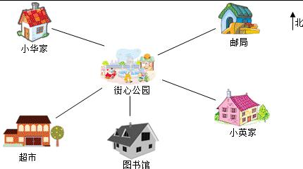

# Mathematics (Grade 3)

**ID**: 728c3ced
**难度**: medium_hard
**题型**: fill_in_the_blank

## 题目

(1)小华家在街心公园的______面，超市在街心公园的______面．
(2)小华从家到图书馆，先向______走到街心公园，再向______即到．
(3)小英从家到邮局，先向______走到街心公园，再向______走即到．

## 解答

**答案**: 西北, 西南, 东南, 南, 西北, 东北

1. Step1:根据地图方向辨别方法'上北下南，左西右东'，观察小华家与街心公园的位置关系，得出小华家在街心公园的西北面
2. Step2:同样依据'上北下南，左西右东'，观察超市与街心公园的位置关系，得出超市在街心公园的西南面
3. Step3:依据地图方向，判断小华从家到街心公园的方向为东南
4. Step4:观察街心公园到图书馆的方向，得出是向南
5. Step5:按照地图方向，判断小英从家到街心公园的方向为西北
6. Step6:观察街心公园到邮局的方向，得出是东北

## 知识点

**知识点**:
  - 方向;路线图．

---
