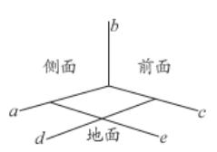

# Mathematics (Grade 3)

**ID**: 73dddc0a
**难度**: medium_hard
**题型**: fill_in_the_blank

## 题目
某教室墙角如下图，认真观察后，明确五条线之间的位置关系。
互相平行的有： $\underline{\hspace{5em}}$ ；
互相垂直的有： $\underline{\hspace{5em}}$ 。

## 解答

**答案**: a∥d, c∥e, a⊥b, b⊥c, d⊥e, a⊥e, a⊥c, c⊥d

1. Step1:根据在同一平面内，不相交的两条直线叫做平行线，观察图中五条线，得出a与d不相交，所以a∥d
2. Step2:根据在同一平面内，不相交的两条直线叫做平行线，观察图中五条线，得出c与e不相交，所以c∥e
3. Step3:根据在同一平面内，相交成直角的两条直线互相垂直，观察图中五条线，得出a与b相交成直角，所以a⊥b
4. Step4:根据在同一平面内，相交成直角的两条直线互相垂直，观察图中五条线，得出b与c相交成直角，所以b⊥c
5. Step5:根据在同一平面内，相交成直角的两条直线互相垂直，观察图中五条线，得出d与e相交成直角，所以d⊥e
6. Step6:根据在同一平面内，相交成直角的两条直线互相垂直，观察图中五条线，得出a与e相交成直角，所以a⊥e
7. Step7:根据在同一平面内，相交成直角的两条直线互相垂直，观察图中五条线，得出a与c相交成直角，所以a⊥c
8. Step8:根据在同一平面内，相交成直角的两条直线互相垂直，观察图中五条线，得出c与d相交成直角，所以c⊥d

## 知识点

**知识点**:
  - 相交与垂直;平行

---
