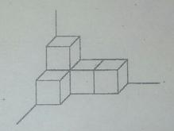

# Mathematics (Grade 3)

**ID**: 7477dd04
**难度**: medium_hard
**题型**: fill_in_the_blank

## 题目
5个棱长为20cm的正方体纸盒堆放在墙角处。（如下图）
 1、从上面看，有(  )个面露在外面；
 2、从前面看，有(  )个面露在外面；
 3、从右面看，有(  )个面露在外面；
 4、露在外面的面积是(  )cm².

## 解答

**答案**: 4, 4, 3, 440

1. Step1:观察图形，从上面看，数出露在外面的面的数量为4个
2. Step2:观察图形，从前面看，数出露在外面的面的数量为4个
3. Step3:观察图形，从右面看，数出露在外面的面的数量为3个
4. Step4:先算出一个面的面积为20×20=400cm²，再算出露在外面的面的总数为4 + 4 + 3 = 11个，最后根据总面积=一个面的面积×面的总数，得出露在外面的面积为400×11 = 4400cm²，整理答案为['4', '4', '3', '4400']

## 知识点

**知识点**:
  - 

---
