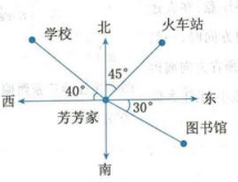

# Mathematics (Grade 3)

**ID**: 771ddb4c
**难度**: medium_hard
**题型**: fill_in_the_blank

## 题目

   （1）学校在芳芳家（    ）偏 （    ）（    ）度的方向上
   （2）火车站在芳芳家（    ）偏（    ）（    ）度的方向上
   （3）图书馆在芳芳家（    ）偏（    ）（    ）度的方向上

## 解答

**答案**: 西, 北, 40, 北, 东, 45, 东, 南, 30

1. Step1:观察图，以芳芳家为观测点，确定学校位置，可得学校在芳芳家西偏北40度方向，提取方向词“西”和“北”以及角度“40”
2. Step2:观察图，以芳芳家为观测点，确定火车站位置，可知火车站在芳芳家北偏东45度方向，提取方向词“北”和“东”以及角度“45”
3. Step3:观察图，以芳芳家为观测点，确定图书馆位置，得出图书馆在芳芳家东偏南30度方向，提取方向词“东”和“南”以及角度“30”

## 知识点

**知识点**:
  - 第二单元位置与方向（二）-第二单元综合测试卷-

---
