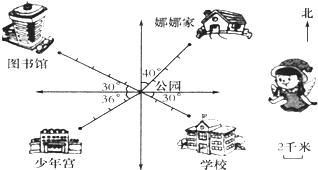

# Mathematics (Grade 3)

**ID**: 790c63cd
**难度**: medium_hard
**题型**: fill_in_the_blank

## 题目
（1）娜娜家在公园的(    )偏(    )的方向上，距离是(    )千米；公园在娜娜家(    )偏(    )的方向上，距离是(    )千米．
（2）以公园为观测点：
①图书馆在公园的(    )偏(    )的方向上，距离是(    )千米；
②少年宫在公园的(    )偏(    )的方向上，距离是(    )千米；
③学校在公园的(    )偏(    )的方向上，距离是(    )千米．

## 解答

**答案**: 北, 东40°, 8, 南, 西40°, 8, 西, 北30°, 10, 西, 南36°, 8, 东, 南30°, 6

1. Step1:根据图中方向辨别方法及所给角度，确定娜娜家在公园的方向为北偏东40°
2. Step2:已知图上距离1厘米代表实际距离2千米，娜娜家到公园图上距离为4厘米，计算得出距离为4×2=8千米
3. Step3:根据方向的相对性，确定公园在娜娜家的方向为南偏西40°，距离同样是8千米
4. Step4:以公园为观测点，确定图书馆在公园的方向为西偏北30°
5. Step5:图书馆到公园图上距离为5厘米，计算得出距离为5×2=10千米
6. Step6:确定少年宫在公园的方向为西偏南36°
7. Step7:少年宫到公园图上距离为4厘米，计算得出距离为4×2=8千米
8. Step8:确定学校在公园的方向为东偏南30°
9. Step9:学校到公园图上距离为3厘米，计算得出距离为3×2=6千米

## 知识点

**知识点**:
  - 根据方向和距离确定物体的位置．

---
