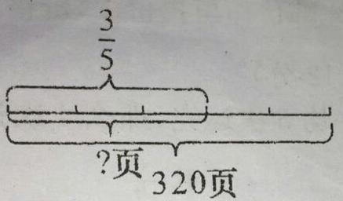

# Mathematics (Grade 3)

**ID**: 7a1f9262
**难度**: medium_hard
**题型**: fill_in_the_blank

## 题目

$\frac{3}{5}$
  ？页   320页

## 解答

**答案**: 192

1. Step1:明确题目是求320的$\frac{3}{5}$是多少，根据解析2，求一个数的几分之几用乘法
2. Step2:列出乘法算式320×$\frac{3}{5}$
3. Step3:按照整数乘以分数的计算方法，分母不变，分子与整数的积作积的分子，即计算$\frac{320×3}{5}$
4. Step4:得出结果为192页

## 知识点

**知识点**:
  - --

---
