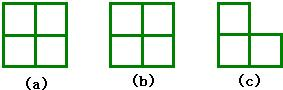

# Mathematics (Grade 3)

**ID**: 7cb835f3
**难度**: medium_hard
**题型**: fill_in_the_blank

## 题目
将几个大小相同的正方体木块放成一堆，从正面看到的视图是图（a），从左向右看到的视图是图（b），从上向下看到的视图是图（c），则这堆木块最多共有$\underline{\hspace{5em}}$ 块．

## 解答

**答案**: 6

1. Step1:根据从上向下看到的视图可知，最底层有3个小正方体
2. Step2:根据从正面看到的视图和从左向右看到的视图可知，第二层最多有3个小正方体
3. Step3:将最底层和第二层小正方体的数量相加，3 + 3 = 6，所以这堆木块最多共有6块

## 知识点

**知识点**:
  - 从不同方向观察物体和几何体．

---
