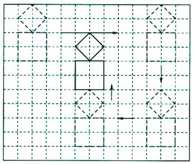

# Mathematics (Grade 3)

**ID**: 7db451bc
**难度**: medium_hard
**题型**: fill_in_the_blank

## 题目
填一填．

蜡烛先向（_______）平移（_______）格，再向（_______）平移（_______）格，又向（_______）平移（______）格，最后向（______）平移（_______）格．

## 解答

**答案**: 右, 9, 下, 6, 左, 5, 上, 4

1. Step1:观察图中蜡烛移动的箭头方向和方格
2. Step2:确定蜡烛第一次移动方向为右，数出移动格数为9格
3. Step3:确定蜡烛第二次移动方向为下，数出移动格数为6格
4. Step4:确定蜡烛第三次移动方向为左，数出移动格数为5格
5. Step5:确定蜡烛第四次移动方向为上，数出移动格数为4格

## 知识点

**知识点**:
  - 

---
