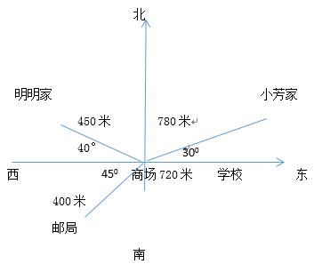

# Mathematics (Grade 3)

**ID**: 80f897e4
**难度**: medium_hard
**题型**: fill_in_the_blank

## 题目
如下图，以商场为观测点，填一填。
（1）明明家的位置是（___________）偏（__________）（__________），距离商场（__________）米。
（2）小芳家的位置是（_______）偏（__________）（__________），距离商场（__________）米。
（3）邮局的位置是（__________）偏（__________）（__________），距离商场（__________）米。
（4）（______）在正东方向，距离商场（__________）米。

## 解答

**答案**: 西, 北, 40°, 450, 东, 北, 30°, 780, 西, 南, 45°, 400, 学校, 720

1. Step1:观察图形，以商场为观测点，明明家在商场的左上方，根据方向规则，左为西，上为北，角度为40°，距离是450米，所以明明家的位置是西偏北40°，距离商场450米
2. Step2:小芳家在商场的右上方，右为东，上为北，角度是30°，距离为780米，即小芳家的位置是东偏北30°，距离商场780米
3. Step3:邮局在商场的左下方，左为西，下为南，角度是45°，距离是400米，可知邮局的位置是西偏南45°，距离商场400米
4. Step4:观察发现学校在商场正右方，右为正东方向，距离商场720米

## 知识点

**知识点**:
  - 小学数学;图形与几何;位置与方向;方向;根据方向、角度和距离确定物体的位置

---
