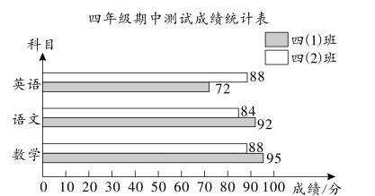

# Mathematics (Grade 3)

**ID**: 8124c49e
**难度**: medium_hard
**题型**: fill_in_the_blank

## 题目
某校四年级两个班期中测试，各班语文、数学、英语三科平均成绩如图所示。

1.四（1）班的语文平均成绩是（）分，四（2）班的英语平均成绩是（）分。
2.两个班的数学平均成绩相差（）分。

## 解答

**答案**: 92, 88, 7

1. Step1:观察统计图，找到表示四（1）班语文平均成绩的条形，其对应的成绩为92分，所以四（1）班的语文平均成绩是92分
2. Step2:观察统计图，找到表示四（2）班英语平均成绩的条形，其对应的成绩为88分，所以四（2）班的英语平均成绩是88分
3. Step3:观察统计图，找到四（1）班数学平均成绩对应的88分和四（2）班数学平均成绩对应的95分，用95 - 88 = 7分，得出两个班的数学平均成绩相差7分

## 知识点

**知识点**:
  - 从统计图表中获取信息

---
