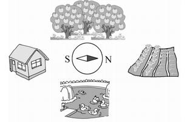

# Mathematics (Grade 3)

**ID**: 830f4a6c
**难度**: medium_hard
**题型**: fill_in_the_blank

## 题目
下图是小明在自己家的院子里用指南针找方向的结果。

小明家院子的南方有（），北方有（）。小明家院子的（）方有果园，（）方有池塘。
回家以后也用指南针找一找你家的四个方向各有什么，并把它们记录下来和小伙伴交流。

## 解答

**答案**: 房屋, 菜地, 西, 东

1. Step1:根据指南针标识，明确N表示北方，S表示南方
2. Step2:以小明家为观测点，确定院子南方对应的物体为房屋
3. Step3:以小明家为观测点，确定院子北方对应的物体为菜地
4. Step4:将自己面朝北，根据右手边是东方，左手边是西方，确定院子西方有果园
5. Step5:确定院子东方有池塘

## 知识点

**知识点**:
  - 辨认方向

---
