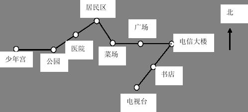

# Mathematics (Grade 3)

**ID**: 84106108
**难度**: medium_hard
**题型**: fill_in_the_blank

## 题目
填一填

（1）医院在居民区的_______面，在公园的______面．
（2）3路车从少年宫出发，向_____行驶_____站在公园，再向______行驶_____站到居民区，再走______站到电信大楼．
（3）小红从电信大楼上车，行驶2站，她可能在______站下车．

## 解答

**答案**: 西南, 东北, 东, 1, 东北方向, 2, 3, 电视台或菜场

1. Step1:根据地图方向“上北下南，左西右东”，判断医院在居民区的西南面
2. Step2:同样依据地图方向，得出医院在公园的东北面
3. Step3:观察3路车行驶路线，从少年宫出发，向正东方向行驶1站到公园
4. Step4:从公园再向东北方向行驶2站到居民区
5. Step5:从居民区再走3站到电信大楼
6. Step6:小红从电信大楼上车行驶2站，可能到达电视台站或菜场站

## 知识点

**知识点**:
  - 小学数学;图形与几何;位置与方向;方向;路线图

---
