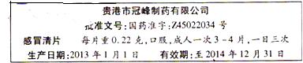

# Mathematics (Grade 3)

**ID**: 8619a9a7
**难度**: medium_hard
**题型**: fill_in_the_blank

## 题目
下面这段文字是一种片剂药包装中的部分使用说明．

根据使用说明：这种感冒清片，成人一天最多服$\underline{\hspace{5em}}$克，保质期有$\underline{\hspace{5em}}$年．

## 解答

**答案**: 2.64, 2

1. Step1:根据说明可知每片重0.22克，一次最多服4片，一日服3次，所以计算成人一天最多服的克数为0.22×4×3，先算0.22×4 = 0.88，再算0.88×3 = 2.64克
2. Step2:由生产日期2013年1月1日和有效期至2014年12月31日，计算保质期，2013年1月1日到2013年12月31日是1年，2014年1月1日到2014年12月31日是1年，所以保质期共2年

## 知识点

**知识点**:
  - 整数、小数复合应用题．

---
