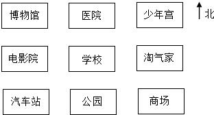

# Mathematics (Grade 3)

**ID**: 8625b6eb
**难度**: medium_hard
**题型**: fill_in_the_blank

## 题目
根据如图完成填空．
(1)学校的北面是______；学校的东面是______；
学校的西面是______；学校的南面是______．
(2)博物馆在学校的______面；汽车站在学校的______面；
少年宫在学校的______面；商场在学校的______面．

## 解答

**答案**: 医院, 淘气家, 电影院, 公园, 西北, 西南, 东北, 东南

1. Step1:根据图和'上北下南，左西右东'，学校上面即北面是医院
2. Step2:学校右边即东面是淘气家
3. Step3:学校左边即西面是电影院
4. Step4:学校下面即南面是公园
5. Step5:博物馆在学校的左上方，根据方位辨别方法是西北面
6. Step6:汽车站在学校的左下方，是西南面
7. Step7:少年宫在学校的右上方，是东北面
8. Step8:商场在学校的右下方，是东南面

## 知识点

**知识点**:
  - 方向．

---
