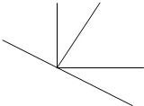

# Mathematics (Grade 3)

**ID**: 86f609c4
**难度**: medium_hard
**题型**: fill_in_the_blank

## 题目
图中共有$\underline{\hspace{5em}}$个角，其中有$\underline{\hspace{5em}}$个直角，有$\underline{\hspace{5em}}$个锐角，有$\underline{\hspace{5em}}$个钝角，有$\underline{\hspace{5em}}$个平角．

## 解答

**答案**: 10, 3, 4, 2, 1

1. Step1:先数出图中单独的小角有4个
2. Step2:按照角的组合规律计算角的总数，即4+3+2+1=10个
3. Step3:根据直角等于90度的定义，数出图中直角的个数为3个
4. Step4:依据锐角小于90度的定义，数出图中锐角的个数为4个
5. Step5:根据钝角大于90度小于180度的定义，数出图中钝角的个数为2个
6. Step6:按照平角等于180度的定义，数出图中平角的个数为1个

## 知识点

**知识点**:
  - 角的概念及其分类．

---
