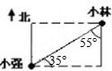

# Mathematics (Grade 3)

**ID**: 8e341045
**难度**: medium_hard
**题型**: fill_in_the_blank

## 题目
如图，小林家在小强家$\underline{\hspace{5em}}$偏$\underline{\hspace{5em}}$35°方向上，小强家在小林家$\underline{\hspace{5em}}$偏$\underline{\hspace{5em}}$35°方向上．

## 解答

**答案**: 东, 北, 西, 南

1. Step1:明确观测点，先以小强家为观测点，根据上北下南左西右东的方向规则，结合图中角度，可知小林家在小强家东偏北35°方向上
2. Step2:再以小林家为观测点，根据上北下南左西右东的方向规则，可知小强家在小林家西偏南35°方向上
3. Step3:按照题目要求的顺序，依次提取方向词，得到答案为东、北、西、南

## 知识点

**知识点**:
  - 方向．

---
