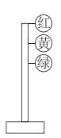

# Mathematics (Grade 3)

**ID**: 8f765f64
**难度**: medium_hard
**题型**: fill_in_the_blank

## 题目

红灯停，绿灯行，黄灯亮了等一等。（hóng dēng tíng ，lǜ dēng háng ，huáng dēng liàng le děng yī děng 。）
黄灯在红灯的（）面，黄灯在绿灯的（）面，绿灯上面有（）灯和（）灯。（huáng dēng zài hóng dēng de （）miàn ，huáng dēng zài lǜ dēng de （）miàn ，lǜ dēng shàng miàn yǒu （）dēng hé （）dēng 。）

## 解答

**答案**: 下, 上, 红, 黄

1. Step1:观察图中红绿灯的位置，确定从上往下依次是红灯、黄灯、绿灯
2. Step2:根据上述位置关系，判断黄灯在红灯的下面
3. Step3:根据位置关系，判断黄灯在绿灯的上面
4. Step4:根据位置关系，确定绿灯上面有红灯和黄灯

## 知识点

**知识点**:
  - 位置与顺序

---
