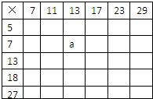

# Mathematics (Grade 3)

**ID**: 941ed681
**难度**: medium_hard
**题型**: fill_in_the_blank

## 题目
如图，每个空格中的数都是它所在行的第一个数与所在列的第一个数的积，如a=7×13，那么这30个空格中的数的总和是______．

## 解答

**答案**: 7000

1. Step1:计算第一行空格数字和，第一行第一个数是5，其所在列的第一个数分别为7、11、13、17、23、29，所以第一行空格数字和为5×(7 + 11 + 13 + 17 + 23 + 29)=5×100
2. Step2:计算第二行空格数字和，第二行第一个数是7，其所在列的第一个数同样为7、11、13、17、23、29，所以第二行空格数字和为7×(7 + 11 + 13 + 17 + 23 + 29)=7×100
3. Step3:计算第三行空格数字和，第三行第一个数是13，其所在列的第一个数还是7、11、13、17、23、29，所以第三行空格数字和为13×(7 + 11 + 13 + 17 + 23 + 29)=13×100
4. Step4:计算第四行空格数字和，第四行第一个数是18，其所在列的第一个数依旧为7、11、13、17、23、29，所以第四行空格数字和为18×(7 + 11 + 13 + 17 + 23 + 29)=18×100
5. Step5:计算第五行空格数字和，第五行第一个数是27，其所在列的第一个数仍是7、11、13、17、23、29，所以第五行空格数字和为27×(7 + 11 + 13 + 17 + 23 + 29)=27×100
6. Step6:计算30个空格数字总和，将每行空格数字和相加，即(5 + 7 + 13 + 18 + 27)×100 = 7000

## 知识点

**知识点**:
  - 数表中的规律．

---
