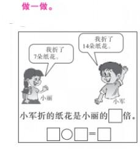

# Mathematics (Grade 3)

**ID**: 96fd0071
**难度**: medium_hard
**题型**: fill_in_the_blank

## 题目

做一做.
小丽：我折了7朵纸花.
小军：我折了14朵纸花.
小军折的纸花是小丽的□倍。
□○□=□

## 解答

**答案**: 2, 14, 7, 2

1. Step1:明确问题是求小军折的纸花是小丽的几倍，也就是求14是7的几倍
2. Step2:根据除法的意义，求一个数是另一个数的几倍用除法计算
3. Step3:列出算式14÷7
4. Step4:计算14÷7的结果为2
5. Step5:得出小军折的纸花是小丽的2倍，答案依次为2、14、7、2

## 知识点

**知识点**:
  - 

---
