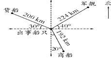

# Mathematics (Grade 3)

**ID**: 977b398d
**难度**: medium_hard
**题型**: fill_in_the_blank

## 题目
看图填空。

（1）军舰在出事船只（______）偏（______）（______）度方向上，距离是（______）km；货船在出事船只（______）偏（______）（______）度方向上，距离是（______）km；商船在出事船只（______）偏（______）（______）度方向上，距离是（______）km。
（2）如果商船以每小时48 km的速度赶往出事地点，需要（______）小时；若军舰与商船同时赶到，则军舰每小时行驶（______）km。

## 解答

**答案**: 东, 北, 40, 224, 西, 北, 30, 200, 南, 东, 20, 192, 4, 56

1. Step1:观察图中军舰与出事船只的位置关系，得出军舰在出事船只东偏北40度方向上，距离是224km
2. Step2:观察图中货船与出事船只的位置关系，得出货船在出事船只西偏北30度方向上，距离是200km
3. Step3:观察图中商船与出事船只的位置关系，得出商船在出事船只南偏东20度方向上，距离是192km
4. Step4:根据路程除以速度等于时间，计算商船赶往出事地点所需时间，192÷48 = 4小时
5. Step5:因为军舰与商船同时赶到，军舰行驶路程为224km，时间为4小时，根据路程除以时间等于速度，计算军舰速度为224÷4 = 56km/h

## 知识点

**知识点**:
  - 小学数学;数与代数;应用题;常见的数学问题;行程问题

---
