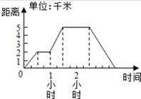

# Mathematics (Grade 3)

**ID**: 98fad031
**难度**: medium_hard
**题型**: fill_in_the_blank

## 题目
小华从家去相距5千米远的图书馆借书，经过情况如右图．

（1）小华在图书馆借书用了________小时．
（2）返回的速度是每小时________千米．

## 解答

**答案**: 1, 5

1. Step1:从统计图可知小华从家到图书馆一共用了1.5小时，在图书馆借书结束时间为2.5小时，所以借书用时为2.5 - 1.5 = 1小时
2. Step2:小华家与图书馆相距5千米，返回开始时间为2.5小时，到家时间为3.5小时，返回用时3.5 - 2.5 = 1小时，根据速度=路程÷时间，可得返回速度为5÷(3.5 - 2.5)=5千米/时

## 知识点

**知识点**:
  - 

---
