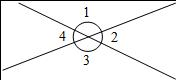

# Mathematics (Grade 3)

**ID**: 99b6a101
**难度**: medium_hard
**题型**: fill_in_the_blank

## 题目
已知∠1=130°，求∠2、∠3、∠4．

## 解答

**答案**: 50°, 130°, 50°

1. Step1:观察图形可知∠1与∠2组成平角，所以∠1 + ∠2 = 180°，已知∠1 = 130°，则∠2 = 180° - 130° = 50°
2. Step2:因为∠2与∠3组成平角，即∠2 + ∠3 = 180°，∠2 = 50°，所以∠3 = 180° - 50° = 130°
3. Step3:由于∠1与∠4组成平角，即∠1 + ∠4 = 180°，∠1 = 130°，所以∠4 = 180° - 130° = 50°

## 知识点

**知识点**:
  - 线段与角的综合

---
